<div align="center">


# Nerd Analytics

**Платформа клиентской поддержки с ИИ-ассистентом и аналитикой для сотрудников**

Пользователь описывает проблему в чате, ИИ-ассистент пытается решить её сам, а если не получается — автоматически классифицирует обращение и создаёт тикет для оператора. Сотрудники видят всё это на шести аналитических дашбордах: SLA, точность ИИ, нагрузка, отзывы, прогнозы и аномалии.


[**Живое демо**](#демо) · [Скриншоты](#скриншоты) · [Запуск](#быстрый-старт) · [Архитектура](#архитектура)

</div>

## Демо

👀 [**Ссылка на демонстрационный сайт**](https://nerdanalytics.ru/)

> **Демо работает без бэкенда.** Включён mock-режим: подойдут любые логин и пароль, пользователь получает роль сотрудника, и все разделы, включая аналитику, доступны сразу.

---

## Возможности

### Для клиентов
- **ИИ-ассистент поддержки.** Чат с историей сессий, прикреплением файлов и оптимистичной отправкой сообщений.
- **Эскалация в тикет.** Если ассистент не решил проблему, он предлагает продукт и категорию (с оценкой уверенности), а пользователь подтверждает приоритет. Так создаётся тикет.
- **Передача оператору.** Чат блокируется в статусе «ожидает оператора» и закрывается, когда проблема решена.
- **Гостевой режим.** Создать обращение и отследить его статус можно без регистрации.
- **Тикеты, уведомления, отзывы** с оценкой качества поддержки, профиль и настройки.

### Для сотрудников (role-based доступ)
Шесть аналитических дашбордов на Recharts:

| Дашборд | Что показывает |
|---|---|
| **Сводная** | KPI, распределение тикетов по статусам, продуктам и категориям, динамика |
| **ИИ** | Точность классификации (как часто админ меняет категорию ИИ), доля автоматически решённых обращений, среднее число сообщений до эскалации |
| **Администраторы** | Нагрузка на сотрудников, соблюдение SLA |
| **Пользователи** | Демография, retention |
| **Отзывы** | Средний рейтинг, тональность, позитивные и негативные ключевые слова |
| **Тикеты (детально)** | Прогноз нагрузки с доверительным интервалом, **детекция аномалий по z-score** за 48 часов |

- Фильтры по датам, продукту, приоритету и категории. Конфигурация **сохраняется отдельно для каждого дашборда**.
- **Экспорт** в CSV, PNG (график) и PDF (дашборд).

## Скриншоты

| Главная | ИИ-ассистент |
|---|---|
| 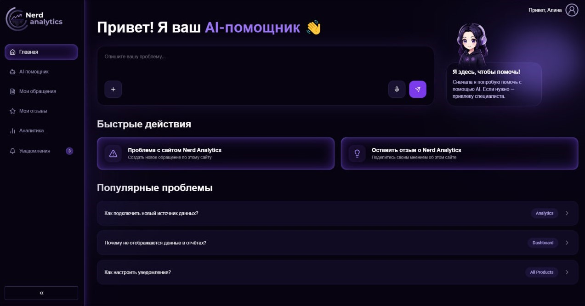 | 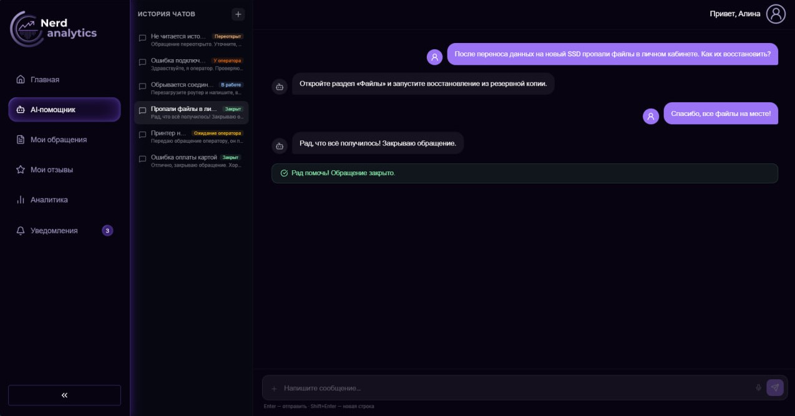 |

| Аналитика | Тикеты |
|---|---|
| 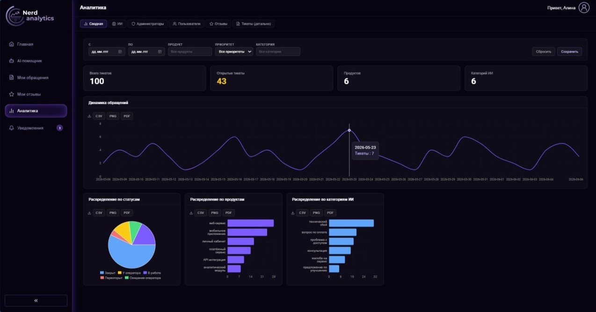 | 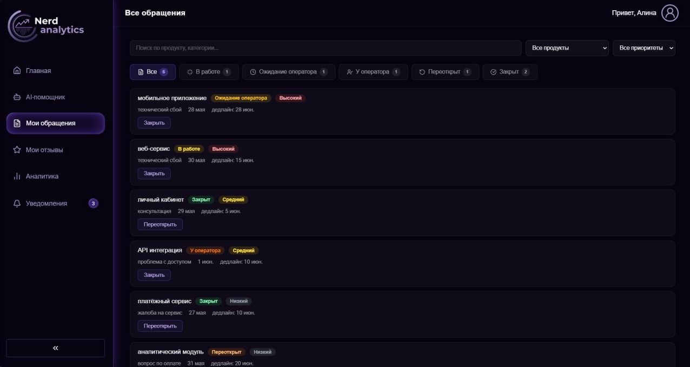 |

| Отзывы | Уведомления |
|---|---|
| 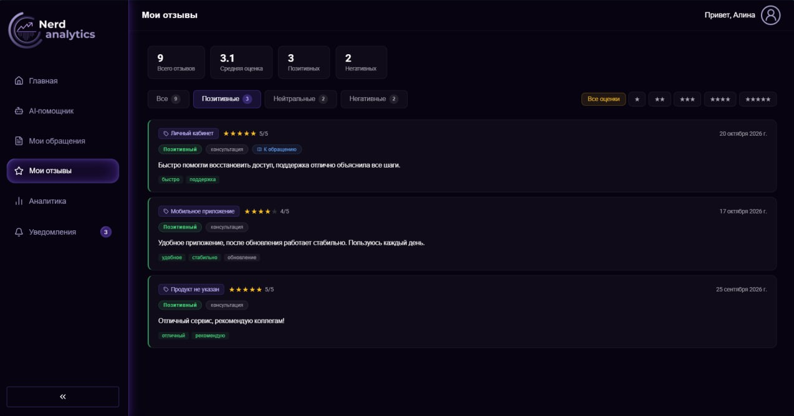 | 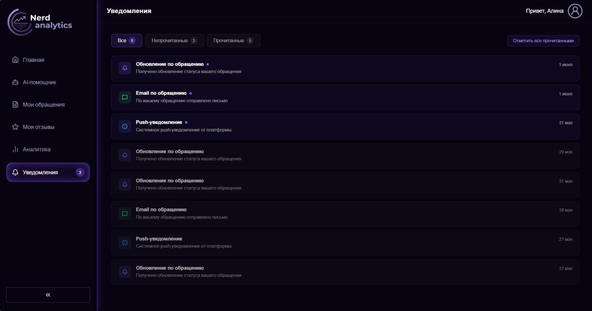 |

| Профиль | Настройки |
|---|---|
| 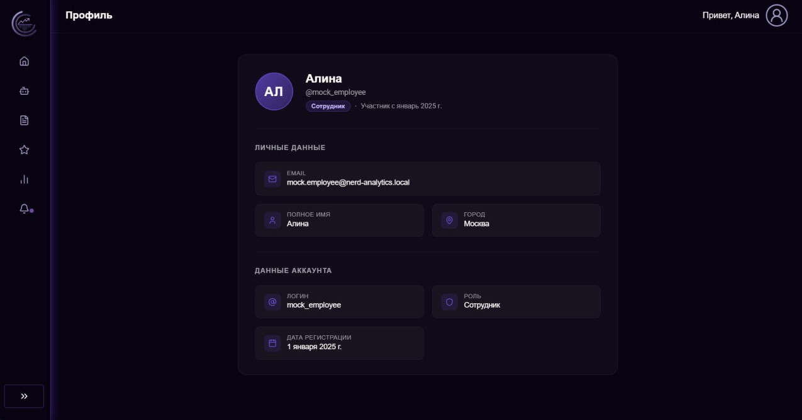 | 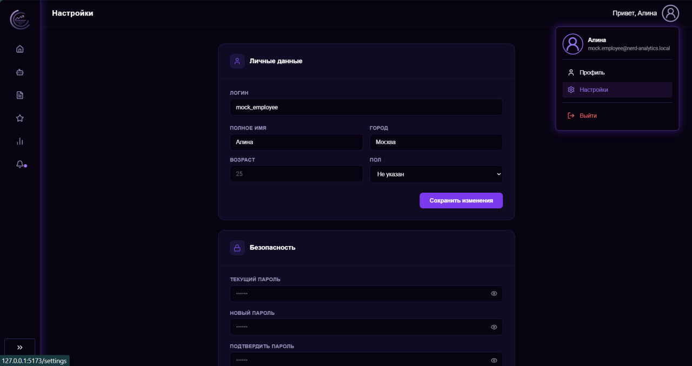 |

| Аутентификация | Регистрация |
|---|---|
| 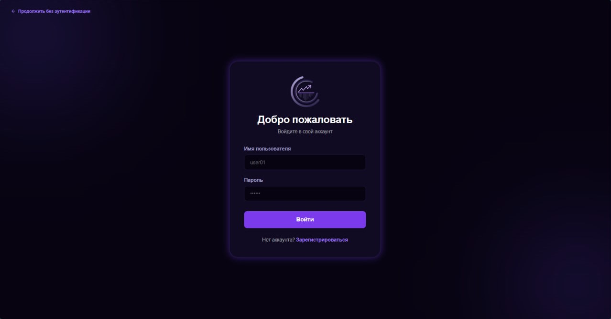 | 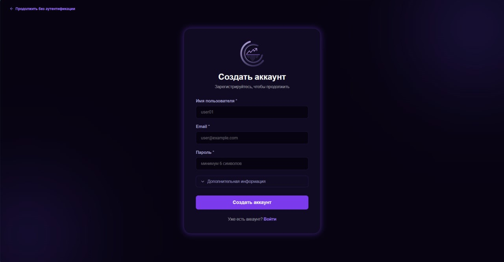 |

---

## Быстрый старт

**Требования:** Node.js 20+, npm.

```bash
git clone https://github.com/AlinaCherrr/nerd-analytics.git
cd nerd-analytics
npm install
cp .env.example .env.local
npm run dev            # http://127.0.0.1:5173
```

### Переменные окружения

| Переменная | Описание | По умолчанию |
|---|---|---|
| `VITE_BASE_URL` | Адрес backend API | `http://localhost:8001` |
| `VITE_IS_MOCK` | `true`: работа на моках без бэкенда, `false`: реальный API | `true` |

---

## Технологический стек

| Слой | Технологии |
|---|---|
| UI | **React 19**, TypeScript 6, SCSS Modules, lucide-react |
| Роутинг | React Router 7 (data router, lazy-страницы, error boundaries) |
| Серверное состояние | **TanStack Query 5**: кеширование, инвалидация, optimistic updates |
| HTTP | Axios с интерсепторами (JWT, refresh, нормализация ошибок) |
| Графики | Recharts 3 |
| Сборка и качество | Vite 8, ESLint 10 (typescript-eslint, react-hooks), Prettier |

---

## Архитектура

Приложение разбито на слои с однонаправленными зависимостями. Каждый слой знает только о слоях ниже.

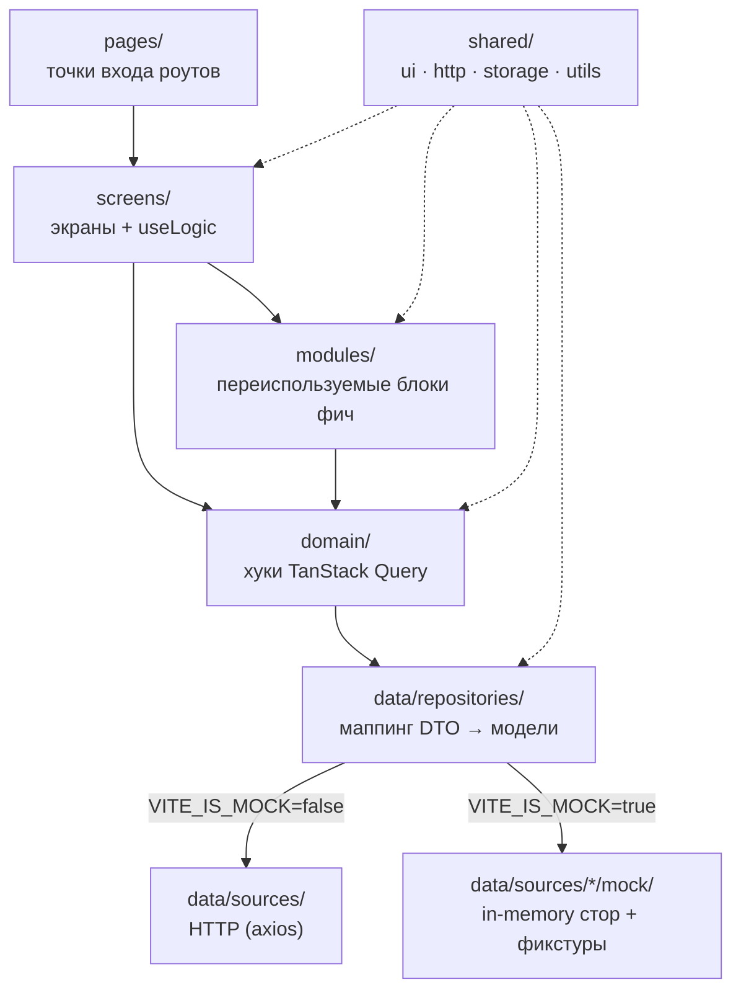

### Структура проекта

```
src/
├── pages/            # Тонкие обёртки для роутера, грузятся лениво (React.lazy)
├── screens/          # Экран целиком. Разметка в `index.tsx`, вся логика в хуке `useLogic`
├── modules/          # модули с бизнес-логикой
├── domain/           # хуки бизнес-сценариев по фичам, TanStack Query
├── data/
│   ├── api/          # apiClient: JWT + refresh-очередь
│   ├── repositories/ # контракты + мапперы + real/mock
│   └── sources/      # HTTP-источники + mock/fixtures
├── router/           # data router, RootLayout, guard-роуты
└── shared/           # ui, http, storage, utils, constants
```

### Пример переключения источника данных

```ts
// data/repositories/Assistant/index.ts: реализация выбирается один раз
export const assistantRepository = IS_MOCK
  ? assistantMockRepository
  : assistantRealRepository

// domain/Assistant/useSendMessage: UI не знает, откуда пришли данные
assistantRepository.sendMessage(sessionId, content, files)
```
